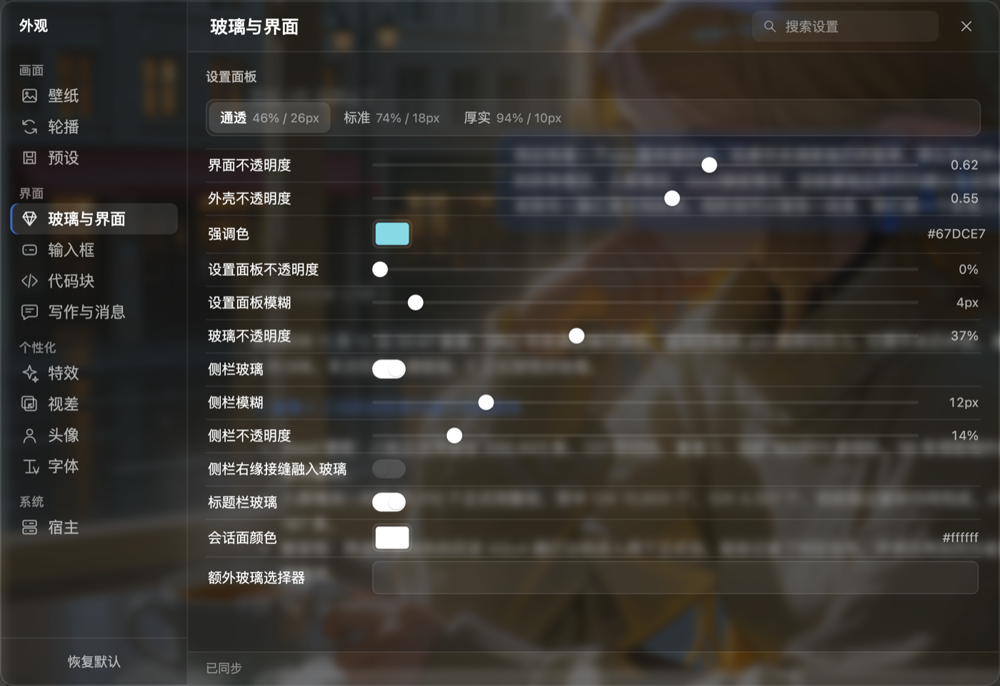

# codex-wallpaper-engine

[](LICENSE)
[](package.json)
[](#)



把你自己的图片与视频做成 **Codex 桌面端** 的壁纸层，再叠上液态玻璃、字体、粒子特效、视差与头像（`/Applications/ChatGPT.app`，bundle id `com.openai.codex`）。

它不修改 `app.asar`，不动 Codex 的任何原生功能。壁纸层是在运行时通过 **CDP** 注入的：在页面 `body` 最前面插一层 z-index 最低的容器，把 Codex 自己的背景壳降成半透明，于是壁纸从界面之后透出来 —— 侧栏、正文、输入框照常能读能点。

```
Codex 主窗口 (app://-/index.html)
├── #root                       Codex 原生 DOM，一个节点都没动
│   ├── aside 左侧栏            背景降到 rgba(255,255,255,.85) → 玻璃
│   └── main 正文               背景降到 rgba(24,24,24,.8) → 壁纸透出
├── #cwe-root        ← 注入    position:fixed; z-index:0; pointer-events:none
│   ├── .cwe-slot ×2           双槽交替，换壁纸有过场
│   ├── #cwe-scrim              黑遮罩，管可读性
│   └── canvas#cwe-fx           点击涟漪 / 鼠标拖尾
└── #cwe-panel-host  ← 注入    Shadow DOM 里的十二页设置面板
```

## 装（三步）

```bash
# 1. 把项目登记成一个本地 marketplace（已装过就跳过）
mkdir -p ~/.codex/wallpaper-marketplace/.agents/plugins ~/.codex/wallpaper-marketplace/plugins
ln -sfn "$(pwd)" ~/.codex/wallpaper-marketplace/plugins/codex-wallpaper-engine
cat > ~/.codex/wallpaper-marketplace/.agents/plugins/marketplace.json <<'JSON'
{
  "name": "cwe",
  "interface": { "displayName": "壁纸引擎" },
  "plugins": [
    {
      "name": "codex-wallpaper-engine",
      "source": { "source": "local", "path": "./plugins/codex-wallpaper-engine" },
      "policy": { "installation": "AVAILABLE", "authentication": "ON_USE" },
      "category": "Productivity"
    }
  ]
}
JSON

# 2. 在 ~/.codex/config.toml 末尾加两行
#    [marketplaces.cwe]
#    source_type = "local"
#    source = "/Users/<你>/.codex/wallpaper-marketplace"
#    [plugins."codex-wallpaper-engine@cwe"]
#    enabled = true

# 3. 装进插件缓存
"/Applications/ChatGPT.app/Contents/Resources/codex-cli/CodexCLI.app/Contents/MacOS/codex" plugin add codex-wallpaper-engine@cwe
```

然后让 Codex 带调试端口起来（**必须**，否则没有注入点）：

```bash
node bin/cwe.mjs launch          # 等价于 ChatGPT --remote-debugging-port=9333
```

用户平时点图标启动的那个 Codex 没有调试端口，壁纸画不上去。两份实例可以并存，互不干扰。

### 开机自启（点 Dock 也带壁纸）

`cwe launch` 只管这一次。要想「以后随手点 Dock 图标启动 Codex 也有壁纸」，开一次自启就行：

```bash
node bin/cwe.mjs autostart on      # 装 launchd 看门人，并立刻把守护拉起来
node bin/cwe.mjs autostart status  # 看装没装、加载没加载、进程在不在
node bin/cwe.mjs autostart off     # 关掉（壁纸本身不受影响，只是不再自动带端口）
```

它做三件事：

1. 写 `~/Library/LaunchAgents/com.codexwallpaper.engine.watch.plist`，`RunAtLoad` + `KeepAlive`，登录即起、挂了自动拉起；
2. 让 `bin/cwe-watch.mjs` 常驻。它只在发现启动约 2 秒内的无端口实例时尝试正常退出，再带端口打开；
3. 顺手把宿主守护也 detach 起来，不用等下次启动。

看门人的日志在 `~/.codex-wallpaper-engine/watch.log`，launchd 自己的 stdout 在 `watch.launchd.log`。两处都安静，就说明一切正常。

> 这一步只支持 macOS。其它平台用 `cwe launch` 手动起。

直接用 `cwe launch` 会从一开始带调试端口，省掉 Dock 启动后的那次重开。注入器会先探测当前文档能否访问本机壁纸服务。只有确认被 CSP 拦截时，才对这一个主窗口 target 尝试一次重载。主界面和图片解码或视频首帧都就绪后才显示壁纸。切换时上一张会持续显示到新画面就绪。

### 从 zip 装（不想要 git 的情况）

```bash
mkdir -p ~/cwe && unzip codex-wallpaper-engine-0.8.0-*.zip -d ~/cwe
cd ~/cwe
# 然后照上面三步走，把 $(pwd) 换成 ~/cwe 即可
node bin/cwe.mjs launch
```

zip 里已经包含全部源码、skills、MCP server 与文档，解压即可用，不需要联网。

## 用

在 Codex 里直接说人话就行 —— skills 与 MCP 工具会接上：

> 给我换张壁纸，字要看得清
> 界面调成液态玻璃，深色那张图
> 打开壁纸引擎面板

命令行也全都能干（`bin/cwe.mjs`，软链成 `cwe` 更好用）：

```bash
cwe status                        # 守护在不在、页面挂上没有、当前哪张
cwe check --json                  # 当前 Codex 版本、页面结构与玻璃选择器命中
cwe list [--type video|image]
cwe use <id>                      # 换壁纸，也接受 next / prev / random
cwe set cweUiAlpha=0.5 scrim=0.2     # 遮挡只调一个杠杆，别同时降 wallpaperOpacity
cwe upload ~/Pictures/foo.png --title "夜空"
cwe panel                         # 在窗口里弹出设置面板（或按 ⌥⌘W）
cwe preset use glass-dark         # 换整套观感
cwe rotation new --name 工作 --interval 20
cwe autostart on                  # 开机自启：以后点 Dock 启动也带壁纸
cwe log -n 80                     # 看宿主日志
```

## 支持的壁纸

只有两类，都来自你自己上传的文件（`cwe upload`，或者设置面板里直接拖进去）：

| 类型 | 格式 | 渲染方式 |
|---|---|---|
| **image** | png / jpg / webp / gif / avif | 背景层（`object-fit`、焦点位置、缩放、翻转都能调） |
| **video** | mp4 / webm | `<video>`，loop、音量、倍速、帧率上限均可调 |

上传目录默认 `~/.codex-wallpaper-engine/uploads`，可以在设置面板「宿主」页改到别处。清单只读这一个目录，不碰任何第三方软件。

单个文件上限 **2GB**（`src/host/uploads.mjs` 的 `UPLOAD_MAX_BYTES`）。请求体是边收边写盘的：先落 `<文件名>.part`，收完才 `rename` 成正式文件，中途超限或断连都会把半截文件删掉，不会留下一个播放不了的坏壁纸。设置面板上传时会显示百分比与已传/总大小；失败会把宿主返回的原因原样打出来（以前只显示「上传失败」，看不出是 413 还是格式不支持）。

视频码率太高时，2GB 以内也可能卡：本机优先用系统自带的 `/usr/bin/avconvert` 压一遍再传，例如

```bash
avconvert --preset Preset1920x1080 --source "原片.mp4" --output /tmp/1080.mp4 --progress
node bin/cwe.mjs upload /tmp/1080.mp4 --title "换个名字"
```

## 能力清单

**壁纸外观**　不透明度 / 模糊 / 亮度 / 对比 / 饱和 / 黑遮罩 / object-fit / 焦点 XY / 缩放 / 翻转 / 五种过场（cut fade slide zoom wipe）
**界面透明度**　`cweUiAlpha`（界面整体遮挡度，默认 0.66）、`cweUiAlphaMain`（外层壳，默认 0.58）—— 和壁纸不透明度是两个方向：一个让壁纸淡，一个让界面透。注入层做「补差值」而不是每层各铺一次色，所以 alpha 不会连乘把壁纸压黑
**液态玻璃**　侧栏、顶栏、右侧面板、搜索、菜单、弹窗、会话摘要和输入框。顶部、右侧与浮层的开关、透明度和模糊均可在「玻璃与界面」页调整。
**输入框玻璃**　`composerGlass` 管输入区（`ComposerLayoutBody`）、`composerChipGlass` 管上面那行「选择项目 / 此计算机」chip —— 只改前者会在玻璃面板顶上留一条深灰实心块，所以默认两层一起改
**底部黑带清理**　Codex 在窗口底部给工具条铺了一层实色背景板（`div[class*="background-"][class*="surface-"]`，1144×116，`rgb(24,24,24)`）和一条 32px 的 `fade-` 渐变带，两者都不吃 `cweUiAlpha`，会在壁纸下缘切出一条不透明黑带。输入框玻璃开启时一并置透明；同时把父级 `ComposerLayoutRoot` 也清掉，避免玻璃面板底下透出深灰
**代码块玻璃**　`codeGlass` 管 GPT 回复里的代码块本体（`Root-iW7ipz`，原生 `rgb(40,40,40)` + 8% 白渐变）和顶栏（`ActionBar-KWWAct`）
**写作与消息玻璃**　`writingGlass` 管 GPT 回复里那块「写作」可编辑面板的三层（外层 + 垫底 + header，只改外层会在玻璃上压一块深灰）；`bubbleGlass` 管我发给它的消息气泡（`div[class*="bg-user-message"]`，原生 `rgb(23,62,118)` 深蓝，内部无实色子层）—— 气泡保留原生蓝，只把不透明度交出来
**字体**　字体集预设（随包 `compact`）+ 系统字体挑选（81 个，可刷新），组件级白名单只改 composer / sidebar / code，不会把界面改坏
**特效**　点击涟漪（ripple/burst/ring/star）、鼠标拖尾（comet/line/dots/spark），尺寸、长度、宽度、发光、混合模式、配色（强调色 / 自定义 / 彩虹）
**视差**　壁纸 / 界面 / 侧栏 / 输入框各自深度，平滑度可调
**头像与吉祥物**　上传图片、尺寸、圆角；右上角绳索挂坠（deepseek/orb/ghost/cat 四种形态）
**轮播**　轮播组（顺序 / 随机、按分钟间隔、或视频播完即换）
**外观预设**　整套观感存成 JSON，可导出分享、导入落地；随包三套
**设置面板**　十二页（含独立的「输入框」「代码块」「写作与消息」三组），Shadow DOM 隔离，改动即时生效，⌥⌘W 唤出；左下角浮球会自动躲到「使用情况」环上方，不压头像
**开机自启**　`cwe autostart on` 装一个 launchd 看门人：登录即起、挂了自动拉；它盯着 Codex 进程，发现裸启动就换成带调试端口的同一份，于是点 Dock 图标也有壁纸

## 设置面板（0.13.0）

面板是 Shadow DOM 浮层，但入口不是外挂浮球：它克隆 Codex 左侧导航栏里原生按钮的结构（同样的 36×36、12.5px 圆角、透明底、线性图标），插在个人资料按钮正上方。Codex 没有暴露设置页扩展点，所以「像内置」靠的是同一套几何、同一套颜色 token、同一套键盘行为。

### 三个老毛病仍然有解

**拖滑杆不再弹回顶部**：几何重绘只在换页或换搜索词时发生，换页前把 `scrollTop` 记进 `scrollMemo[当前页]`；数值改动走 `syncField(key)`，只改读数与滑杆，不换 DOM。拖动期间重绘延后，松手 260ms 后放行，另有 900ms 兜底 —— 指针移出窗口再松手也不会把面板卡住。数据到位后的刷新走 `paint(true)`，不会被「同页不重绘」的早退挡在占位文案上。

**面板本身是玻璃**：`background: rgba(var(--base), var(--ga))` + `backdrop-filter: blur(var(--gb)) saturate(1.25)`，1px 亮边与 1px 内高光负责厚度。「玻璃与界面」页顶部仍是三档：

| 档位 | 不透明度 | 模糊 |
|---|---|---|
| 通透 | 46% | 26px |
| 标准 | 74% | 18px |
| 厚实 | 94% | 10px |

默认落在标准档；旧 `config.json` 里的值不迁移。系统开启「减少透明度」时自动退回实色。

**预设不会假丢**：`normValues()` 把磁盘预设与导入内容都过一遍 `sanitize + pickAppearance` 再比较，同观感直接指向已有条目（`existing: true`）；导入、删除都可撤销。列表每行给出键数、时间和观感摘要（`壁纸 55% · 模糊 0px · 亮 100% · 对比 104%`），同名的几套一眼可分。

```bash
node tools/dedupe-presets.mjs          # 只报分组，不动文件
node tools/dedupe-presets.mjs --apply  # 把副本搬进 presets/.dedupe-<时间戳>
```

### 这一版改了什么

- **原生入口**：不再往导航里塞一个样式不同的按钮，而是复制原生按钮的 DOM 结构，清掉 `data-*` / `aria-*` 后只留壁纸图标与 `aria-label`。入口落在个人资料上方 44px 处；导航重排时由 MutationObserver 补挂，且只允许当前实例补挂。
- **宿主 token**：从 Codex 读取 `--color-text` / `--color-surface` / `--color-border` / `--font-ui-size` / `--dialog-radius` / 强调色，写进面板的 `--host-fg` / `--base` / `--line` / `--font-size` / `--radius` / `--accent`。浅色与深色跟随 `html[data-theme]`，切换不需要重开面板。
- **克制的尺寸**：960×680 卡片、188px 竖排导航、32px 行高、16px 页标题、13–14px 正文、8px 滚动条。选中态只用一条 2px 强调色，开关是 34×20 的真 `button[role=switch]`。
- **壁纸网格**：去掉每张图上的「图片」标签，只在视频上留「视频」；文件名改为悬停 / 选中时出现，默认只让画面说话。
- **键盘与焦点**：`role=dialog` + `aria-modal`，Tab 在卡内首尾循环，Esc 关闭，关面板把焦点还给打开前的元素；`prefers-reduced-motion` 下关闭过渡。
- **窄窗口**：≤900px 收窄导航与留白，≤680px 全屏；900×720 下无横向溢出。`forced-colors` 下退回系统色。
- **生命周期**：`panel.destroy()` 清掉全部 timer、观察器、键盘监听、原生入口、Shadow host 与 `window.__CWE.panel`；注入器用 `version + fp` 判断页面里的实例是否还活着，旧连接与重复连接会被取消。卸载后页面里不留下任何入口。
- **窄屏键盘可达**：所有可点元素都是 `button`，`:focus-visible` 有独立描边；原生入口也保留 `aria-label` 与 `title`。

### 0.13.0 补的四件事

**能删掉自己传过的壁纸了**：网格里每张图右上角有一个删除按钮（悬停或键盘聚焦时显形，窄屏常显）。删除前弹出确认，写明文件名和「不能撤销」；如果删的正好是当前在用的那张，会先切到清单里的下一张再刷新，中间不留黑屏。按钮走宿主的 `POST /remove`，与 `cwe remove <id>` 是同一条路径。

那一格现在是 `div` 里包两个按钮：整块的 `.hit` 负责「用它」，右上角的 `.del` 负责「删它」。不能写成 `button` 套 `button`（HTML 解析会把内层甩出去）；标签、类型角标、勾选圈统一 `pointer-events: none`，否则点在文件名上等于什么都没点。

**端口不再撞**：Codex 用 `--remote-debugging-port=P` 启动，P 要是被别的程序占着，它那个监听根本绑不上，注入器只会一直等 —— 日志干净得像「没事发生」。现在 `src/host/port-pick.mjs` 先把 `cwePort … cwePort+11` 扫一遍：

- 该段里已有 DevTools 端点 → 直接复用（重启守护时这是常态）
- 否则找第一个真正空闲的端口
- 全被占着 → 仍试配置值，但日志和 `runtime.json` 都会写清楚

`runtime.json` 现在多了 `cdpPortPreferred` 与 `cdpPortState`（`cdp` / `free` / `busy`），外部工具读它就够，不用自己再猜一遍。同时修掉了 `server.listen()` 每试一次就多挂一个 `error` 监听器、挂上不摘的泄漏；固定端口被占现在会明确失败，不再盲试 +12 次。

**应用位置不再写死**：`src/host/app-path.mjs` 按平台列出候选（`/Applications`、`~/Applications` 下的 `ChatGPT.app` / `Codex.app`，Windows 的 `%LOCALAPPDATA%\Programs`，Linux 的 `/opt`、`/usr/bin`），也可以用 `CWE_APP_BIN=/path/to/Codex` 直接指定。找不到时 `cwe launch` 会把找过的路径全列出来。看门人进程在找不到应用时只守宿主，不会拿空串去匹配进程名（那会把整机进程当成 Codex）。

**排版与兼容性**：

- 字体栈补齐 `Hiragino Sans GB` / `Microsoft YaHei` / `Noto Sans CJK SC` / `Source Han Sans SC` / `system-ui`
- 卡片高度补 `100dvh`（旧引擎忽略，天然回退到 `100vh`）
- `.tile` 补 `@supports not (aspect-ratio)` 的 `padding-bottom: 62.5%` 兜底
- 设置行补 `:hover / :focus-within` 高亮（原来写死 `transparent`，等于没有）
- 分区标题加 4px 上边距、导航分组字距 `.02em`，把 12 个 tab 的密度拉开一点
- 通透档时侧栏也补一层底（`.card[data-thin="1"] .nav`），否则 46% 下导航文字会被背后亮壁纸吃掉

> 宿主侧新增字段要重启 Codex 才生效：插件进程里的 `presets.mjs` 是启动时加载的。面板对缺失字段做静默降级，不会报错。

## 架构

三层，各管一件事：

```
┌─ Codex 插件层 ────────────────────────────────────────────┐
│ .codex-plugin/plugin.json   skills/   .mcp.json            │
│ 16 个 MCP 工具（stdio JSON-RPC）→ 一律走本机 HTTP           │
└───────────────────────────────────────────────────────────┘
                              │
┌─ 宿主服务层 (Node, 零依赖) ─────────────────────────────────┐
│ 127.0.0.1 随机端口 HTTP + 22 条路由 + 内存 token             │
│ inventory / media / presets / routes-faces / uploads        │
│ controller / injector / settings-schema / cdp / config      │
└───────────────────────────────────────────────────────────┘
                              │  CDP
┌─ 注入层 (页面内) ───────────────────────────────────────────┐
│ runtime.js  壁纸层 + 玻璃 CSS + FX canvas + 视差 + 吉祥物    │
│ panel.js    十二页设置面板 (Shadow DOM)                       │
└───────────────────────────────────────────────────────────┘
```

**为什么用 CDP 而不是改 app.asar**：Codex 的插件扩展面只有 skills / MCP server / hooks 三类，没有浏览器渲染注入点。改 asar 会在每次应用更新时失效，还有签名问题。CDP 只在运行时动 DOM 与 CSS，关掉守护、刷新窗口就完全复原。

## 关键约束（改代码前必读）

1. **CSP**　注入器用本机宿主的状态接口验证访问。收到该请求的 `connect-src` 拦截事件后才设置 `Page.setBypassCSP`，并至多对当前主窗口 target 重载一次。同一 CDP 会话内的新文档就绪后会自动应用最新配置。详见 [Chrome DevTools Page 协议](https://chromedevtools.github.io/devtools-protocol/tot/Page/)。
2. **后台窗口冻结媒体**　窗口在后台时 `document.visibilityState === "hidden"`，Chrome 会冻结媒体管线，`<video>` 永远停在 `readyState 0`（图片不受影响，所以只有视频壁纸发黑）。解法：`Page.setWebLifecycleState({state:"active"})` + `Emulation.setFocusEmulationEnabled`。
3. **版本号是换代码的开关**　改 `runtime.js` 或 `panel.js` 时升该文件的 `VERSION`。面板也可通过更新自己的 `FP` 触发重装。
4. **token 只在内存**　所有对外 URL 带 token，清单里绝不出现真实路径；token 存内存 Map，重启即失效，所以缓存不能存 token。
5. **只绑 127.0.0.1**　宿主端口每次重启都会变（`listen(0)` 自动分配），重启后必须重推 payload。
6. **只注入主窗口**　`app://-/index.html`；avatar-overlay 与 detached-window 两个副窗不碰。
7. **CDP 两条硬限制**　① 不能 `Target.createTarget`（"not supported in Owl"），只能 attach 已存在的 target ② iframe target 上不能 `Page.reload` / `Page.captureScreenshot`（"only on top-level targets"），要截图只能回主窗口。现在壁纸不走 iframe，这两条只影响调试。

Codex 更新后，按 [桌面窗口适配](docs/DOM-MAP.md) 运行只读检查和渲染回归。当前主壳无法识别时，插件回退到原生外观。各个浮层的规则独立匹配。

## 目录

```
.codex-plugin/plugin.json   Codex 插件清单
.mcp.json                   MCP server 声明（stdio）
skills/                     两个 skill：用法 / 排障
mcp/server.mjs              零依赖 MCP server，16 个工具
mcp/launch.sh               找 node 的启动壳（打包后 PATH 未必有 node）
bin/cwe.mjs                 CLI，18 个子命令（含 autostart）
bin/cwe-watch.mjs           launchd 看门人：给裸启动的 Codex 补调试端口
src/host/                   宿主服务层
  cdp.mjs                   CDP 客户端（零依赖，Node 内置 WebSocket）
  injector.mjs              连接 / CSP / 可见性 / 注入 / 重连
  controller.mjs            配置 → payload → 推送，轮播推进
  server.mjs                HTTP 路由
  inventory.mjs             壁纸清单（只扫上传目录 + 内存 TTL 缓存）
  presets.mjs               外观预设
  faces.mjs                 吉祥物 / 头像 / 字体集 / 系统字体
  routes-faces.mjs          mascot / avatar / fontsets / system-fonts 四个 handler
  settings-schema.mjs       132 个配置键 + 7 组 UI schema
  media.mjs                 Range / MIME / CORS / body
  uploads.mjs tokens.mjs config.mjs data-dir.mjs fs-paths.mjs
src/inject/
  runtime.js                页面运行时（壁纸 / 玻璃 / FX / 视差 / 吉祥物 / 字体）
  panel.js                  十二页设置面板
assets/
  fontsets/compact.json     随包字体集
  plugin/icon.svg           插件图标
docs/                       ROUTE-INDEX.md（路由）+ DOM-MAP.md（注入点实测）+ 验证截图
tools/                      探针与测试（见下）
```

## 测试

```bash
node tools/test-server.mjs            # 宿主起来了、路由通
node tools/test-presets.mjs           # 预设 15 项
node tools/test-rotation.mjs          # 轮播推进 7 项
node tools/test-faces.mjs             # 吉祥物/头像/字体集 12 项
node tools/test-payload.mjs           # 载荷组装
node tools/test-mcp-rotation.mjs      # MCP 13 项
node tools/test-mcp-faces.mjs         # MCP 12 项
node tools/test-mcp-preset.mjs        # MCP 预设 8 项
node tools/e2e.mjs --shot out.png     # 真机端到端（要 Codex 带 9333）
node tools/pack.mjs --dry             # 打包清单（不落盘）
node tools/pack.mjs                   # 打 zip 到 dist/（版本号取 package.json）
```

## 卸载

```bash
node bin/cwe.mjs autostart off # 先摘掉开机自启与看门人（否则它会把 Codex 再带端口拉起来）
node bin/cwe.mjs uninstall     # 从页面移除一切注入，Codex 立刻回到原生外观
node bin/cwe.mjs stop          # 停守护
```

数据都在 `~/.codex-wallpaper-engine/`（config.json、uploads、cache、presets、日志）。删掉等于重置。

Codex 本体全程没有被改动过，所以任何一步出错都能靠「停守护 + 刷新窗口」回到干净状态。

## 出处与致谢

这个插件的功能蓝图来自 **dsh-wallpaper-engine** —— 一个给 DeepSeek Harness 做的同类插件：

- 源码：<https://github.com/elysia395/dsh-wallpaper-engine>
- 作者：elysia395，MIT License

壁纸层 + 液态玻璃 + 特效 / 视差 / 头像这套东西，最早是它做出来的。本项目把它的功能面
搬到了 Codex 桌面端：设置项的字段面（`settingsVersion 8`）、配置键的命名与分组、
字体集格式 `dsh-we/fontset@1`、以及首次运行时从 `~/.dsh-wallpaper-engine` 迁移数据的做法，
都沿用了上游。

两边宿主环境完全不同 —— DSH 的插件跑在自己的 Web 界面里，Codex 的插件没有渲染扩展点 ——
所以宿主层与注入层是重写的：这边通过 CDP 在运行时注入 DOM 与 CSS，不改 `app.asar`。
换句话说这是**功能移植**，不是 fork，也没有复制上游的源码文件；但同源关系在这里写明。

上游是 MIT，本项目同样以 MIT 发布。细节见 [NOTICE](NOTICE)。

## 许可

MIT，Copyright (c) 2026 SakuraYH1080 (geniusyfish)。完整文本见 [LICENSE](LICENSE)。
